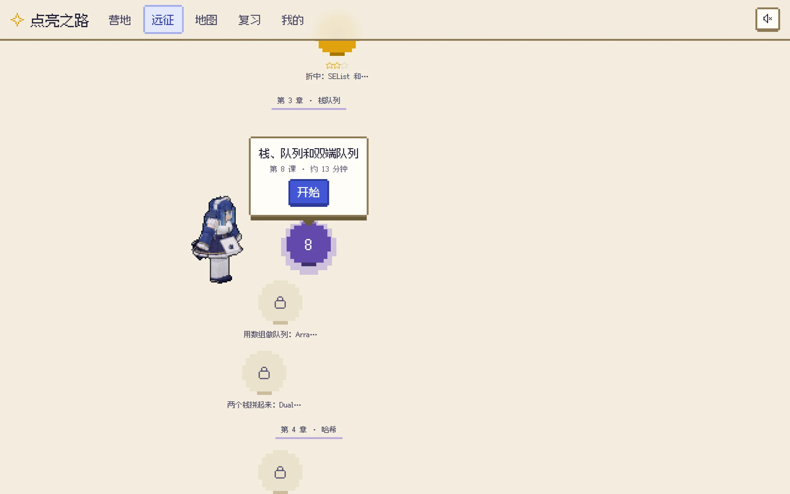
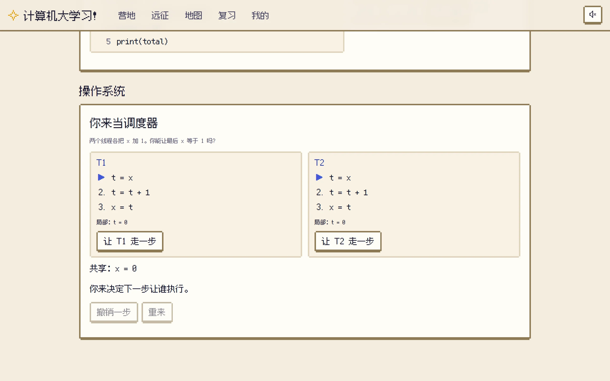
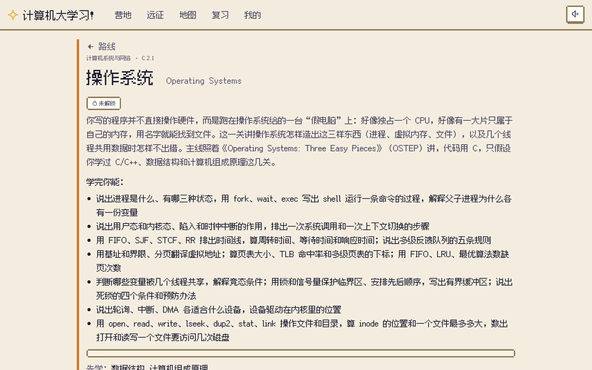
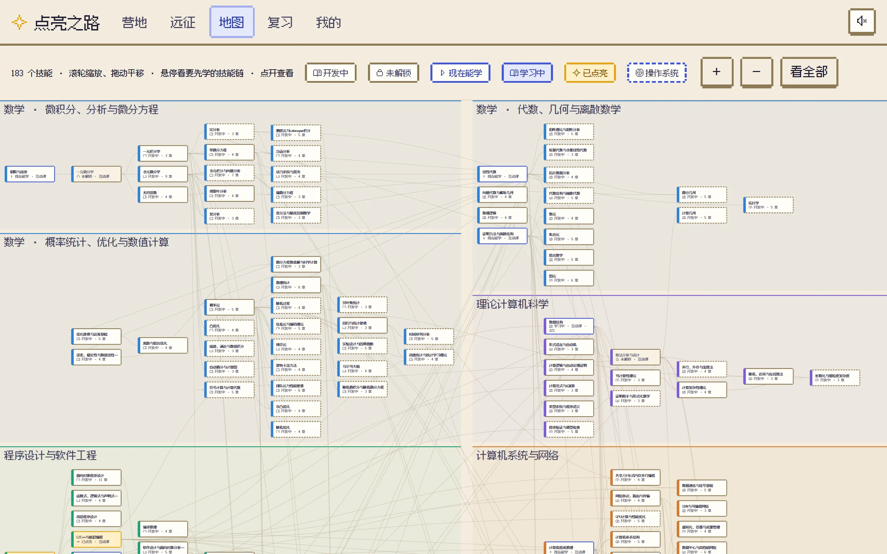

<p align="center">
  
</p>

<h1 align="center">点亮之路</h1>

<p align="center">
  把计算机专业和它要用的数学，做成一款<b>一次一小课</b>的像素风学习游戏。<br>
  先猜、再看、再做；难的机制自己动手“当一回”；做过的题按记忆规律回来复习。
</p>

<p align="center">
  <a href="https://github.com/zeroa234/cs-math-skill-game/releases/latest"><b>下载安卓 App</b></a> ·
  <a href="https://zeroa234.github.io/cs-math-skill-game/"><b>在线玩（网页版）</b></a> ·
  <a href="https://github.com/zeroa234/cs-math-skill-tree"><b>背后的技能树</b></a> ·
  <a href="#玩起来是什么样">玩起来是什么样</a> ·
  <a href="#从源码运行">从源码运行</a>
</p>

<p align="center">
  <a href="https://github.com/zeroa234/cs-math-skill-game/releases/latest"></a>
  
  
  <a href="LICENSE"></a>
</p>

> A pixel-art learning game for a computer-science degree and the math behind it: bite-sized lessons (guess, read, do), hands-on simulators where you play the scheduler or the page-replacement algorithm, spaced repetition (FSRS), and a pointer to the textbook section behind every chapter. Built on [cs-math-skill-tree](https://github.com/zeroa234/cs-math-skill-tree). Android app and offline web page, in Chinese.

## 预览

<table>
  <tr>
    <td width="50%"><br><b>远征</b>：从零走到“操作系统”的 5 站，每章是一枚蜿蜒排开的关卡，下一关弹出“开始”</td>
    <td width="50%"><br><b>一课</b>：先猜一猜（不计分），答完马上给对错和为什么，答错不扣任何东西</td>
  </tr>
  <tr>
    <td><br><b>你来当调度器</b>：两个线程各把 x 加 1，你来决定谁先跑，亲手做出竞态</td>
    <td><br><b>技能页</b>：每章都写明去哪本教材的哪一节深入，要先学什么、为什么，附大学课程证据</td>
  </tr>
  <tr>
    <td><br><b>营地</b>：继续当前远征、今天该复习几题、等级和连续天数</td>
    <td><br><b>技能地图</b>：183 个技能一张图，缩放拖动，点开就是技能页</td>
  </tr>
</table>

<p align="center">
  
  
  
</p>

## 玩起来是什么样

- **一次一小课**：每课几分钟。先猜一猜（不计分），再看讲解卡，再做练习；答完马上知道对错和为什么，答错不扣任何东西。
- **自己动手“当一回”**：你来当调度器，决定两个线程谁先跑，亲手做出竞态和死锁；你来当页面置换算法，每次缺页时点要换出的页；Python 代码一步一步执行给你看。课里遇到过的实验都收进“实验室”，随时再玩。
- **按记忆规律复习**：做过的题由 FSRS 排期，快忘的时候回来，跨技能混在一起复习。
- **一整棵技能树**：183 个技能、242 条“要先学”。每个技能写明学完能做什么、要先学什么和为什么，每章指向教材的哪一节，附大学课程证据。
- **远征**：选一个目标，路线由技能树自动排出。现在能玩的是“我的远征：操作系统”，从“程序是什么”一路走到操作系统，5 站 124 课；和推荐远征“算法”，从第一个证明走到网络流和字符串匹配，4 站 129 课。
- **像素风，有声音**：像素字体和界面、14 张像素背景、8-bit 音效、25 首背景音乐（4 种风格可选）；两位导师鲸鱼娘姐妹会陪你学习。
- **不用注册**：在线网页版需要联网打开；安卓 App、Windows 安装版装好后，电脑版 ZIP 解压后，都能离线游玩。进度存在本机，可以导出和导入。

## 下载和游玩

- **安卓 App**：在 [发布页](https://github.com/zeroa234/cs-math-skill-game/releases/latest) 下载 `cs-math-skill-game-<版本>.apk`（标着“点亮之路”），第一次安装时允许“安装未知应用”。以后 App 每天自己检查一次有没有新版本（“我的”页最下面也能手动检查），覆盖安装进度不丢。
- **Windows 安装版**：在发布页下载 `cs-math-skill-game-<版本>-windows-x64-setup.exe`，双击安装（只装给当前用户，不用管理员权限），开始菜单里打开“点亮之路”，不用联网。新版本要重新下载安装，进度保留。
- **电脑版 ZIP**：在发布页下载 `cs-math-skill-game-<版本>-web.zip`，解压后双击里面的 `index.html`，用浏览器玩，不用联网。
- **网页版**：[在线打开](https://zeroa234.github.io/cs-math-skill-game/)，需要网络连接。进度存在浏览器里，可以导出和导入。

## 现在有多少内容

| | |
|---|---|
| 技能 | 183 个，242 条必须前置（没点亮不能学下一个） |
| 能玩的远征 | **我的远征：操作系统**：程序设计基础 → C/C++ → 数据结构 → 计算机组成原理 → 操作系统；**推荐远征“算法”**：证明方法与离散结构 → 程序设计基础 → 数据结构 → 算法分析与设计 |
| 互动课 | 12 个技能，383 课：“我的远征”的 5 个，“算法”路上的证明方法与离散结构、算法分析与设计，加上推荐远征“人工智能”路上的 5 个（极限与连续、线性代数、数据科学导论、一元微分学、Python 与科学计算工具）。共 384 道“先猜”、1511 张讲解卡、1876 道即时判题的练习、142 道结业挑战题（第一次答对 ≥ 80% 才点亮） |
| 交互组件 | 12 种：位与补码、栈和队列、哈希表、图（BFS / DFS、拓扑排序、Dijkstra、最大流）、CPU 调度、分页、竞态与死锁、页面置换、Python 单步执行、函数图像（极限、割线、泰勒、黎曼和）、2×2 矩阵变换、梯度下降 |
| 其余 171 个技能 | “开发中”：章节教材、前后置、综合练习和参考答案都能看，供自学，暂时不能点亮 |
| 推荐远征 | 8 条（网站、企业应用、手机应用、嵌入式、DevOps、AI、网络安全、算法）：“算法”已开放，其余 7 条开发中；选法见 [docs/recommended-routes.md](docs/recommended-routes.md) |

课里的每个数值、输出和报错都用真实的 Python 或 gcc 跑过核对，每道交互题的标准答案由判题代码自动验证。逐项明细和核对方法见 [docs/development.md](docs/development.md)。

## 从源码运行

需要 Node.js 和 Python。构建脚本从同级目录的 [cs-math-skill-tree](https://github.com/zeroa234/cs-math-skill-tree) 读取技能数据，所以两个仓库要放在一起：

```bash
git clone https://github.com/zeroa234/cs-math-skill-tree.git
git clone https://github.com/zeroa234/cs-math-skill-game.git
cd cs-math-skill-game
npm install
npm run build        # 生成 output/web/，双击 index.html 就能玩
npm test             # 单元测试；端到端、无障碍、手机宽度等见 docs/development.md
```

打包安卓 App：`node scripts/android/build-apk.mjs`，产物在 `output/apk/`。工具、签名密钥、发新版本见 [docs/android.md](docs/android.md)；版本号只在 `package.json` 里改一处。

## 文档

| 文档 | 内容 |
|---|---|
| [docs/design.md](docs/design.md) | 为什么这样设计，每条依据来自哪里 |
| [docs/architecture.md](docs/architecture.md) | 数据模型、组件接口、核心 API、界面地址；怎么加路线、组件、内容包 |
| [docs/content-authoring.md](docs/content-authoring.md) | 互动课怎么写：写给零基础的标准、知识覆盖面标准 |
| [docs/development.md](docs/development.md) | 内容明细、界面一览、目录、测试、内容是怎么来的、和原技能树相比改了什么、自写的部分 |
| [docs/android.md](docs/android.md) | 安卓 App：打包、签名、发新版本、自动检查更新、和网页版的差别 |
| [docs/recommended-routes.md](docs/recommended-routes.md) | 八条推荐远征怎么选的 |
| [docs/promo-video.md](docs/promo-video.md) | 宣传片怎么做：文稿、真实游戏截图、像素 3D 镜头、旁白和渲染步骤 |
| [reports/](reports/) | 启发式评估和手机版复查、逐节覆盖表、KTH 课程先修交叉核对、调研 |

## 已知限制

- 只有 12 个技能有互动课。其余 171 个只供自学，不记录完成、不点亮。推荐远征里只有“算法”开放了；“人工智能”路上已写好的 5 个技能可以在地图上学，但这条路要等每一站都写好才开放。
- 改版只经过一名评估者的启发式评估和自动审计，还没有真人试玩。还没改的问题见 [reports/hci/phone-review.md](reports/hci/phone-review.md)（比如地图初始缩放下文字太小）。
- 进度只存在本机（浏览器或 App）里；换设备要导出、导入。
- 交互组件为教学做了简化：调度器按整数时间单位，分页只有一级页表，线程模型只有赋值、锁和信号量，页面置换只有 FIFO、LRU 和最优三种（时钟算法只在课里讲）。

## 用到的开源组件

| 组件 | 许可 | 用途 |
|---|---|---|
| [Preact](https://preactjs.com/) 10.29.8 | MIT | 界面 |
| [ts-fsrs](https://github.com/open-spaced-repetition/ts-fsrs) 6.0.0 | MIT | 间隔复习排程（FSRS-7） |
| [@panzoom/panzoom](https://github.com/timmywil/panzoom) 4.6.2 | MIT | 地图平移缩放 |
| [KaTeX](https://katex.org/) 0.18.11 | MIT | 公式 |
| [marked](https://marked.js.org/) 18.1.3 + marked-katex-extension 5.1.13 | MIT | Markdown |
| [canvas-confetti](https://github.com/catdad/canvas-confetti) 1.9.4 | ISC | 三星彩带 |
| [ZzFX](https://github.com/KilledByAPixel/ZzFX) 1.4.0 | MIT | 8-bit 音效，播放时合成，没有音频文件 |
| OpenGameArt 上的音乐：Juhani Junkala（SubspaceAudio）、RandomMind、HoliznaCC0 | CC0 | 背景音乐 25 首（[assets/music/README.md](assets/music/README.md)）；用浏览器自带的 `<audio>` 播放 |
| [Fusion Pixel Font](https://github.com/TakWolf/fusion-pixel-font) 12px 简中（比例版 + 等宽版，2026.10.25） | OFL-1.1 | 全部文字的像素字体，代码用等宽版（`assets/fonts/`，许可证同目录） |
| [pixelarticons](https://github.com/halfmage/pixelarticons) 2.4.2 | MIT | 像素图标（`src/game/ui/icons.jsx`） |
| [Capacitor](https://capacitorjs.com/) 8.5.3（core、cli、android）+ app 8.1.2、filesystem 8.1.5、share 8.0.3 | MIT | 安卓 App 外壳、返回键、App 里导出存档；图标用 @capacitor/assets 4.0.0 切图 |
| esbuild、js-yaml、ajv、playwright-core | MIT / MIT / MIT / Apache-2.0 | 构建、内容格式校验、测试（开发依赖） |

哪些是自己写的、为什么没用现成库：[docs/development.md](docs/development.md)“自写的部分”。

## 许可证

本项目（代码、课程内容、文档、像素背景、图标和两位导师的素材）采用 [CC BY-NC 4.0](LICENSE)（知识共享 署名-非商业性使用 4.0）：可以分享和改编，但要署名，并且不能用于商业目的。使用导师素材时还要署名角色设计者（见下面的署名）。第三方部分保留各自的许可证：npm 依赖见上面的组件表，像素字体是 OFL-1.1，背景音乐是 CC0。

## 署名

- **鲸鱼娘（鲸鱼姐姐、鲸鱼妹妹）**：角色设计作者 **ZipZipPipe**，许可 [CC BY-NC 4.0](https://creativecommons.org/licenses/by-nc/4.0/)。本游戏做了这些改动：蓝发姐姐的立绘去掉了背景；黑发妹妹是在原设计上衍生的黑色女仆版（同一画风的立绘和三视图）；两人的像素小人是照设定（发色、鲸鳍耳、尾巴、女仆装）自己建的方块 3D 小人，眼睛放大了一些，长裙改成了短裙。素材在 `assets/cast/`（来源和处理见其 README）。游戏里“我的 → 角色来源”也写着这条署名。
